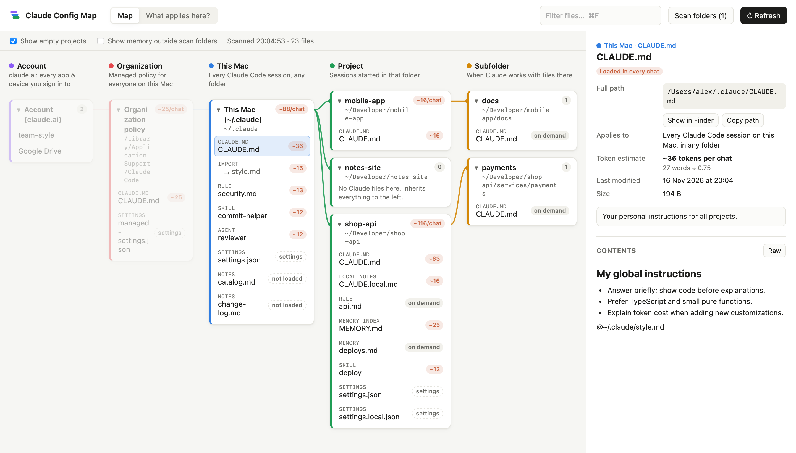
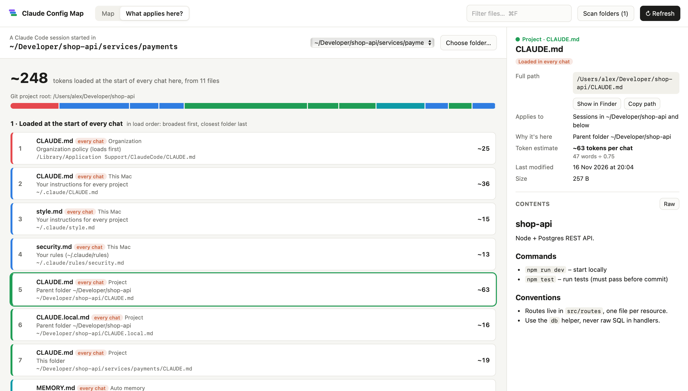
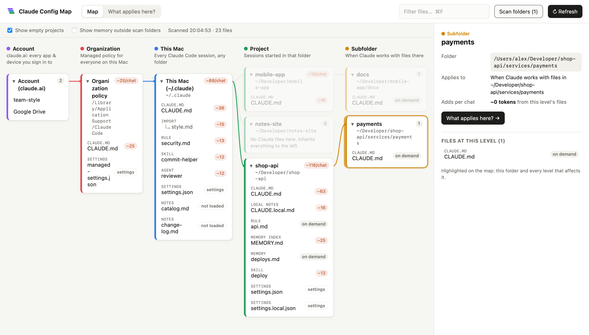

# Claude Config Map

A small Mac app that shows, visually, every **Claude Code** instruction and config file on your Mac and how they stack: which file affects which sessions and folders, and how many tokens each one adds to every chat.



- **Map:** every file by level (Account → Organization → This Mac → Project → Subfolder), with lines showing what applies to what. Click a file to see what it applies to. Click a folder to see everything that affects it.
- **What applies here?** Pick any folder to see the exact stack of files a Claude Code session there loads, in load order, with a per-chat token estimate.
- **File details:** full path, rendered contents, what it applies to, last modified date, and an estimated token cost marked *loaded in every chat* or *loaded on demand*.
- **Private and offline:** read-only, no network access, no dependencies. Nothing is sent anywhere.



## Install

1. Download `Claude-Config-Map.zip` from the [Releases](../../releases) page and unzip it.
2. Drag **Claude Config Map.app** into your **Applications** folder.
3. Open it. The app isn't notarized by Apple, so the first time macOS will say it can't verify the developer:
   - Click **Done** (or **Cancel**), then open **System Settings → Privacy & Security**, scroll down and click **Open Anyway** next to "Claude Config Map".
   - On macOS 14 or earlier, you can instead right-click the app → **Open** → **Open**.
4. Optional: right-click its Dock icon → **Options → Keep in Dock**.

Requires macOS 12 or later, on Apple Silicon or Intel.

## Use

- **Scan folders:** click **Scan folders** to add or remove the folders that contain your projects (for example `~/Developer`). On first launch the app picks common ones that exist (`~/Developer`, `~/code`, `~/Projects`, …). Each direct subfolder and each git repository inside becomes a project.
- **Refresh** (⌘R) rescans after you edit a file.
- **Filter** (⌘F) dims files whose name, path or contents don't match.
- **Show memory outside scan folders** also lists auto-memory folders Claude Code keeps for folders you haven't added.
- **Show in Finder / Copy path** on any file.



## What it scans

| Level | Files |
|---|---|
| **Account** | Not on disk (claude.ai skills, connectors, plugins). If you keep a `~/.claude/catalog.md` with a `## 1 · Account` table, its rows are shown here. Optional. |
| **Organization** | `/Library/Application Support/ClaudeCode/CLAUDE.md`, `managed-settings.json`, `managed-settings.d/*.json` |
| **This Mac** | `~/.claude/CLAUDE.md` (and its `@imports`), `~/.claude/rules/`, `~/.claude/settings.json`, `~/.claude/skills/`, `~/.claude/agents/`, plus `catalog.md` and `change-log.md` if present (shown but not counted: they aren't loaded into chats) |
| **Project** | `CLAUDE.md`, `.claude/CLAUDE.md`, `CLAUDE.local.md`, `.claude/rules/`, `.claude/settings.json`, `.claude/settings.local.json`, `.claude/skills/`, `.claude/agents/`, and auto memory in `~/.claude/projects/<project>/memory/` |
| **Subfolder** | `CLAUDE.md` files and `.claude/` folders nested inside a project |

### How loading is modeled

Based on the [Claude Code memory docs](https://code.claude.com/docs/en/memory), [settings docs](https://code.claude.com/docs/en/settings), [skills](https://code.claude.com/docs/en/skills) and [subagents](https://code.claude.com/docs/en/sub-agents):

- **Every chat:** managed `CLAUDE.md` first, then `~/.claude/CLAUDE.md` and your rules, then every `CLAUDE.md` / `CLAUDE.local.md` from the filesystem root down to the session's folder (closest last), including `@imported` files (up to 4 hops). Rules without `paths:` frontmatter load too. Auto memory: the first 200 lines or 25 KB of `MEMORY.md`.
- **Name and description in every chat, body on demand:** skills and subagents.
- **On demand:** `CLAUDE.md` files in subfolders (when Claude works with files there), rules with `paths:`, memory topic files.
- **Not sent to the model:** settings files (permissions, model, hooks). Priority, lowest to highest: user → shared project → local project → managed.

Token estimates are **words ÷ 0.75**. They don't include Claude Code's own system prompt and tools, MCP servers, plugins, or account-level skills.

## Privacy

- The app only **reads** the files above. It never modifies, moves or deletes them.
- The only file it writes is its own list of scan folders: `~/Library/Application Support/ClaudeConfigMap/config.json`.
- It makes no network requests. Links inside rendered files open in your browser only when you click them.

## Build from source

Needs only Apple's Command Line Tools (`xcode-select --install`). No Xcode project, no packages.

```bash
./build.sh            # → dist/Claude Config Map.app (universal)
./build.sh --install  # build and copy to /Applications
./build.sh --zip      # build and make dist/Claude-Config-Map.zip for a release
```

Project layout:

```
Sources/main.swift      native app: window, read-only scanner, "what applies here" logic
Resources/web/          the interface (HTML/CSS/JS, no libraries)
tools/make-icon.swift   draws the app icon
tools/make-demo.sh      builds the fake "alex" data used for the screenshots
docs/                   screenshots and their demo data
```

Command-line helpers for debugging: `ClaudeConfigMap --dump-scan` prints the scan as JSON, and `ClaudeConfigMap --dump-stack <folder>` prints what applies in that folder.

## Uninstall

Delete `/Applications/Claude Config Map.app` and `~/Library/Application Support/ClaudeConfigMap/`.

## License

[MIT](LICENSE). This is an independent community tool, not affiliated with or endorsed by Anthropic. "Claude" is a trademark of Anthropic.
